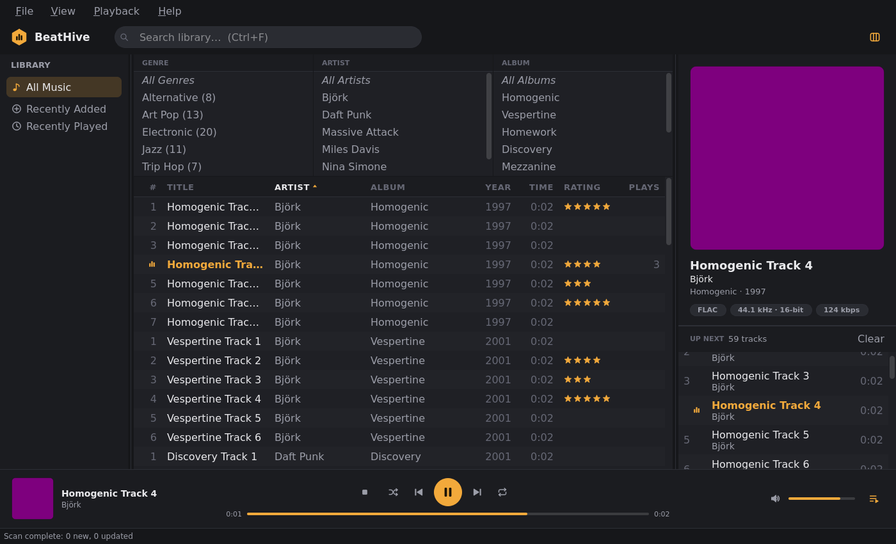

# BeatHive

A music library manager and player for **Linux and Windows**, inspired by MusicBee. Written in C++23 with Qt 6.
Built for big local collections: scan your folders, browse by genre/artist/album, search instantly, and play gaplessly.

> Early development (v0.1). See [SPEC.md](SPEC.md) for the full MVP plan and roadmap.



## What works today

- **Look & feel**: custom dark and light themes (View ▸ Theme) with a honey accent, painted vector icons, a flat sortable header, now-playing highlight, and a now-playing card with format badges

- **Library**: add folders, fast incremental scanning (multi-threaded), tags read from MP3, FLAC, Ogg Vorbis, Opus, M4A and more
- **Browse & search**: sortable/reorderable track table, Genre | Artist | Album filter browser, instant full-text search, click the stars in the Rating column to rate a track
- **Playback**: gapless, FFmpeg decoding, queue with shuffle/repeat, "play next", play counts
- **Cover art**: embedded pictures, or a folder image (`cover.jpg`, `Folder.jpg`, `Front.png`, `Album - Title.jpg`, parent folder for `CD1/CD2` layouts, ...)
- **Tests**: ~120 unit and UI tests, including audio continuity checks and a threaded-playback stress run

Not yet: playlists UI, tag editor, equalizer / ReplayGain, media-key integration, live folder watching.

## Download

Prebuilt packages are on the Releases page: `beathive-<version>-x86_64.pkg.tar.zst` (Arch; install with `sudo pacman -U <file>`, which pulls in the dependencies and adds BeatHive to your app menu) and `beathive-<version>-windows-x64.zip` (self-contained; unzip and run `beathive.exe`). Pushing a `v*` tag builds and publishes both via GitHub Actions.

## Build

Requirements: CMake ≥ 3.25, Ninja, a C++23 compiler (GCC 13+, Clang 17+, MSVC 2022), Qt 6 (Widgets),
FFmpeg, TagLib 2, SQLite. Catch2, nlohmann-json and miniaudio are downloaded automatically.

```sh
# Arch Linux example
sudo pacman -S cmake ninja qt6-base qt6-svg ffmpeg taglib sqlite

cmake --preset release
cmake --build --preset release
./build/release/src/app/beathive
```

Then use **File ▸ Library Folders…** to add your music.

## Test

```sh
cmake --preset dev && cmake --build --preset dev && ctest --preset dev
```

UI tests run headless (`QT_QPA_PLATFORM=offscreen`).

## Layout

| Path | What |
|---|---|
| `src/core` | UI-independent library: data model, SQLite layer, tag I/O, scanner, playback engine |
| `src/ui` | Qt widgets and models |
| `src/app` | The `beathive` executable |
| `tools/` | `bh_scan` (index a folder from the terminal) and `bh_play` (gapless CLI player) |
| `tests/` | Unit and UI tests, with tiny audio fixtures in `tests/data` |

## Developer options

```sh
beathive --data-dir DIR --add-folder MUSIC --null-audio       # scratch library, silent output
beathive ... --screenshot out.png [--autoplay-row N]           # render the window to a PNG and exit
```

Your library database and settings live in `~/.local/share/beathive/` (Linux), never in the repo.
